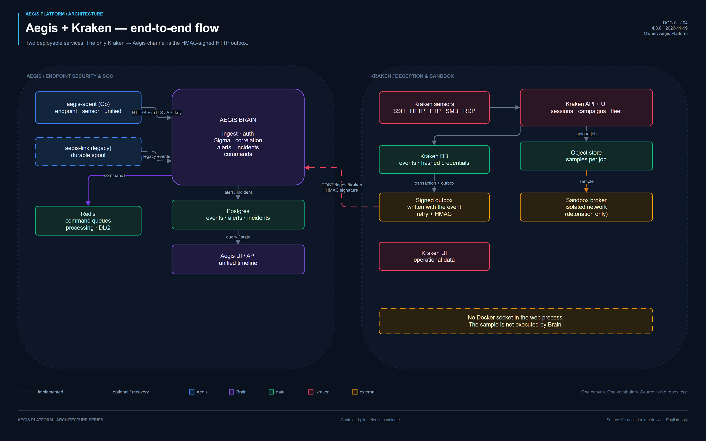
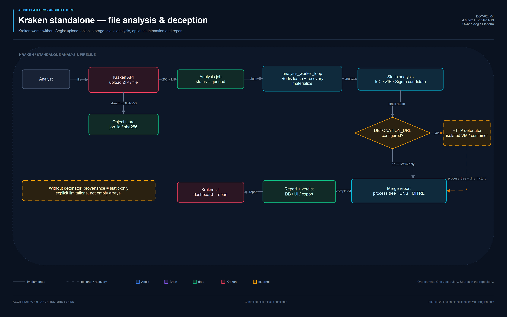
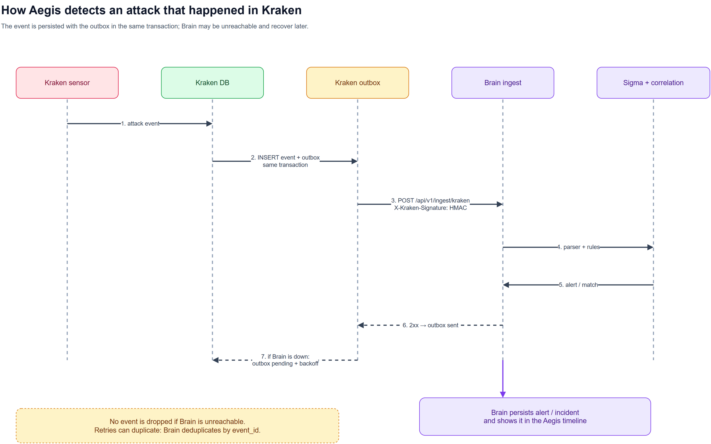
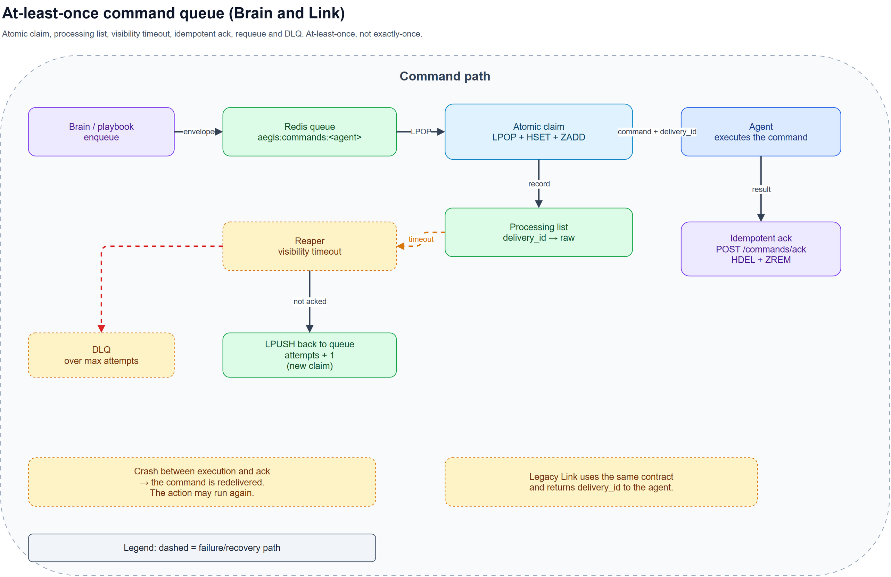
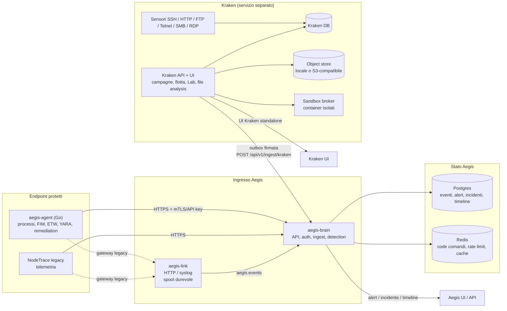
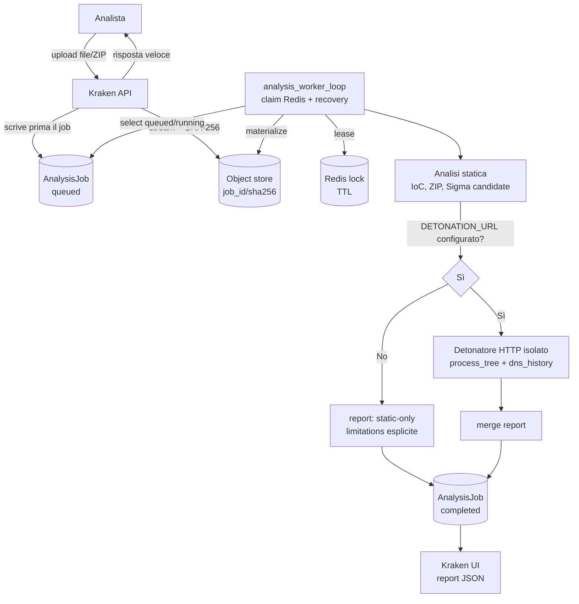
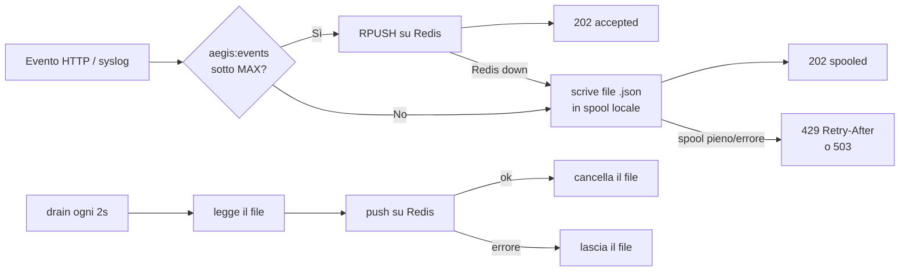
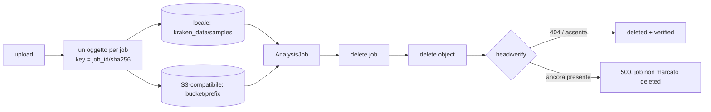

# Aegis + Kraken — architettura e flussi

Data: 2026-11-19. Questo documento descrive il codice del workspace, non un
disegno futuro. Le parti marcate **simulate** sono state provate con Redis,
Postgres e un detonatore HTTP locale; non sono state provate contro un
detonatore malware di produzione.

## 0. Diagrammi puliti (draw.io)

Le quattro figure seguenti sono la versione da leggere. I sorgenti modificabili
sono in `docs/diagrams/*.drawio`; gli export PNG/SVG sono accanto a loro.









I blocchi Mermaid nelle sezioni successive restano il dettaglio tecnico; le
figure sono il percorso di lettura.

## 1. Vista d'insieme



Il confine è deliberato: Kraken ha database, Redis, rete e credenziali propri.
Il Brain non riceve il Docker socket e non esegue codice non fidato. L'unico
canale Kraken → Aegis è HTTP firmato con HMAC; l'unico canale Aegis → Kraken è
l'SSO delegato/UI, non una condivisione di DB.

## 2. Kraken da solo



Cosa può fare Kraken senza Aegis:

- raccogliere attacchi dai sensori e mostrare eventi, campagne, sensori e Lab;
- gestire la flotta (chiavi per nodo, config firmata, heartbeat, revoca);
- caricare un sample, conservarlo nell'object store, analizzarlo in modo
  statico, generare IoC e un candidato Sigma;
- cancellare il sample e verificare che l'oggetto non sia più recuperabile;
- usare un detonatore esterno per ottenere process tree e DNS history;
- esportare report/CSV/JSON/PDF e usare la propria UI/API.

Cosa **non** fa Kraken da solo: non contiene un host endpoint, non fa
remediation, non sostituisce il SIEM e non esegue malware nel processo web.
La sandbox interattiva esistente serve a osservare sessioni, non è un
detonatore di malware: per quello serve un worker esterno isolato.

## 3. Come Aegis rileva ciò che accade in Kraken

```mermaid
sequenceDiagram
    autonumber
    participant S as Sensore Kraken
    participant K as Kraken API/DB
    participant O as Outbox Kraken
    participant B as Brain ingest
    participant P as Parser + SIEM pipeline
    participant A as Alert/Incidente
    participant T as Timeline Aegis
    participant U as UI Aegis

    S->>K: evento attacco (SSH, HTTP, SMB, ...)
    K->>K: salva evento + riga outbox nella stessa transazione
    K-->>O: evento pending
    O->>O: claim, batch, backoff
    O->>B: POST /api/v1/ingest/kraken<br/>X-Kraken-Signature: sha256=HMAC
    B->>B: verifica HMAC, freschezza (7 giorni), max 500 eventi
    B->>P: parser Kraken + ingest_payload
    P->>P: Sigma + correlazione multi-sensor
    P->>A: alert (o fallback Kraken se nessuna regola matcha)
    B->>B: upsert deception_sessions + incidente
    A->>T: evento/alert nel timeline unificato
    T->>U: vista Aegis in lettura
    B-->>O: 2xx; outbox marcata sent
    Note over O,B: se il Brain è spento, l'outbox resta pending<br/>e ritenta con backoff; nessun evento viene cancellato
```

La rilevazione non dipende dal fatto che l'analista apra la UI Kraken. Kraken
scrive l'evento e la riga outbox nella stessa transazione; il worker outbox
ritenta con backoff e con una finestra di stale-recovery. Il Brain valida la
firma HMAC sul corpo grezzo, quindi applica il parser `kraken`, le regole Sigma
e la correlazione. Per i sensori senza una regola dedicata esiste un alert
Kraken di fallback, ma non viene duplicato se una regola ha già matchato.
`deception_sessions` e l'incidente ricostruiscono la storia dell'attacco.

## 4. Coda comandi: da at-most-once ad at-least-once

```mermaid
sequenceDiagram
    autonumber
    participant B as Brain
    participant Q as Redis queue
    participant P as Redis processing
    participant G as aegis-agent Go
    participant D as DLQ

    B->>Q: enqueue atomico (Lua)<br/>envelope: id, command, attempts
    alt coda piena
        Q-->>B: 0, depth
        B-->>B: CommandQueueFull (nessun falso "accodato")
    end
    G->>Q: poll batch
    Q->>P: claim atomico + visibility timeout<br/>attempts += 1
    P-->>G: comando + delivery_id
    G->>G: esegue
    G->>B: POST /commands/ack<br/>{delivery_id, command, status}
    B->>P: LREM per delivery_id
    Note over G,P: crash prima dell'ack → il comando torna in Q<br/>dopo il lease; possibili duplicati
    P->>D: attempts > COMMAND_MAX_DELIVERIES
```

Proprietà reali:

- accodamento atomico e bounded: `CommandQueueFull` viene propagato, non
  silenziato;
- consegna **at-least-once** sul percorso agente Go → Brain: il comando non
  ackato viene reclamato di nuovo;
- ack idempotente per `delivery_id`; il fallback per nome comando serve ai
  client legacy;
- dopo `COMMAND_MAX_DELIVERIES` il comando finisce in DLQ;
- non è exactly-once: un crash tra esecuzione e ack può duplicare l'azione.
  Le azioni devono essere idempotenti o verificabili.

Il gateway `aegis-link` serve agenti legacy con lo stesso contratto: claim
atomico (Lua), processing list, visibility timeout, `delivery_id`, ack
idempotente e requeue/DLQ. Gli endpoint sono `POST /api/v1/commands/ack` e
`POST /api/v1/telemetry/commands/ack`. Un client che non invia l'ack non viene
considerato riuscito; il comando viene riconsegnato. Resta at-least-once, non
exactly-once. Verificato live il 2026-11-19 (claim, ack, doppio ack,
requeue senza ack).

## 5. Link: backpressure + spool durevole



Il file viene scritto prima della risposta. Il drain cancella solo dopo un push
riuscito. Un crash tra push e delete può duplicare, non perdere: il contratto è
at-least-once. Il percorso diretto con coda Redis piena risponde `202 spooled`,
non `429`, perché l'evento è già persistito. `429`/`503` restano per spool
disabilitato, pieno o non scrivibile.

## 6. File analysis: storage e cancellazione



La chiave include il `job_id`, quindi due upload con lo stesso SHA-256 hanno
due oggetti distinti. Non esiste un refcount condiviso da mettere in race:
cancellare un job non può cancellare il sample di un altro.

### 6.1 S3, MinIO e AWS: cosa è stato davvero provato

S3 è un'API, non un singolo fornitore. L'adapter usa `boto3`, endpoint
configurabile, path-style quando serve e una chiave per job. È quindi
compatibile con AWS, Garage, Ceph e altri store S3-compatibili **nel sottoinsieme
di operazioni che usiamo** (PUT, GET, HEAD, DELETE); “S3-compatibile” non
significa copertura completa dell'API.

- **Testato live:** Garage v2.5.0 su `127.0.0.1:3900`, bucket `kraken-live`,
upload/download/delete e due oggetti identici indipendenti. Esito `PASS`.
- **Non testato:** AWS e MinIO AIStor. Non vanno dichiarati provati.
- **MinIO Community:** repository archiviato e niente più binari ufficiali
  mantenuti; il sorgente resta AGPLv3, ma non è una base di deployment
  mantenuta. **MinIO AIStor Free:** è gratis, ma è single-node, con licenza
  proprietaria e redistribuzione vietata; non è open source e non va
  redistribuito nella repo. Non è un problema di “immagine a pagamento”: è un
  problema di licenza e di modello di deployment.
- **AWS:** S3 Standard, listino `us-east-1`, circa `$0,023/GB-mese` per i primi
  50 TB, `$0,005/1.000` PUT e `$0,0004/1.000` GET. L'egress è `$0,09/GB` oltre
  i 100 GB/mese. Un esempio da 10 GB, 100.000 PUT e 50.000 GET costa circa
  `$0,75/mese` di storage/richieste, prima dell'egress. I nuovi account hanno
  crediti (fino a `$200`), non il vecchio tier fisso da 5 GB/12 mesi. I prezzi
  vanno riverificati al momento dell'acquisto.
- **Scelta:** il default resta locale; S3 è opzionale per produzione. Per un
  test self-hosted usare Garage (o Ceph), non MinIO Community. Per un pilota
  AWS, creare un bucket dedicato con retention e cancellazione verificate.


## 7. Garanzie e limiti

| Area | Garanzia verificata | Limite dichiarato |
|---|---|---|
| Storage locale | un oggetto per job; delete verificata | il volume locale non è off-site |
| S3-compatibile (Garage) | adapter boto3, chiavi per job, delete + head | provato live contro Garage v2.5.0; non contro AWS o MinIO AIStor |
| MinIO | — | Community archiviata; AIStor Free single-node e licenza proprietaria; non incluso |
| Job analysis | recupero `queued`/`running` con lease Redis | un job può essere ritentato dopo crash; l'analisi deve essere idempotente |
| Process tree/DNS | importati da `DETONATION_URL` e mostrati in UI | senza detonatore il report dice `static-only`; detonazione malware reale post-4.3 (AP-126) |
| Coda comandi | at-least-once, ack, visibility, DLQ su Brain e Link | duplicati possibili; non exactly-once |
| Link | spool durevole + ack legacy | drain at-least-once; spool locale da montare su volume persistente; check+push atomico (Lua) |
| Kraken → Aegis | outbox + HMAC + retry/backoff | serve un Brain raggiungibile e secret configurato |

## 8. Verifica live del 2026-11-19

| Controllo | Evidenza | Esito |
|---|---|---|
| Link, test | `mvn -B -q test`, JDK 25 | verde |
| Link, ack live | claim con `delivery_id`, ack, doppio ack idempotente, requeue senza ack | verde |
| Link, evento live | POST evento → `202 accepted`; Redis queue/processing/DLQ `0/0/0`; riga `telemetry` in Postgres | verde |
| Brain, coda comandi | `test_command_queue.py` su Redis reale | 8 passed |
| Brain, cap concorrente | 20 producer, cap 5: 5 accodati, 15 `queue_full` | verde |
| Brain, restart consumer | processo worker esce senza ack, nuovo processo dopo il lease | stesso `delivery_id`, `attempt=2` |
| Link, cap 50k | 50.001 richieste HTTP, 128 worker, Redis senza consumer | 50.000 accepted, 1 × 429, LLEN 50.000, 0 × 5xx |
| Agente Go | `go test -count=1 ./...` | tutti i package verdi |
| Profilo unificato | `--profile unified --check` | exit 0 |
| UI build | `npm run build` | exit 0 |
| UI Playwright | 13 test, SSO, pagine, Kraken, nessun asset esterno | 13 passed |
| Kraken seed | evento creato, outbox `sent=1` | verde |
| S3 adapter | Garage v2.5.0, upload/download/delete, due oggetti identici | PASS |
| Diagrammi | 4 `.drawio`, export PNG/SVG | 4/4 |
| Detection baseline | 14 malicious + 14 benign | 14 TP, 0 FN, 5 FP, 9 TN |

La detonazione è stata provata con un server HTTP locale che restituisce un
report controllato: verifica il percorso di rete, la validazione SHA-256, il
merge di `process_tree`/`dns_history` e la UI/API che li espone. Non è stata
eseguita su un campione reale in un detonatore malware di produzione.

Il percorso evento Link → Redis → Brain è stato provato live il 2026-11-19:
Link ha risposto `202 accepted`, il consumer ha svuotato coda e processing,
la DLQ è rimasta a 0 e il Postgres ha ricevuto la riga `telemetry`.

Non è stato provato: AWS o MinIO AIStor live, il job CI ospitato sul tag
candidato e il crash reale di un processo consumer. I test di integrazione
della telemetria restano **11 skipped** senza lo stack completo: non sono
“passed”. La detonazione malware reale è esplicitamente post-4.3 (AP-126):
la 4.3 dichiara solo l'integrazione HTTP, non una sandbox certificata.

La baseline è sintetica: i 5 falsi positivi benigni sono `powershell`, `cmd`,
`python`, `rundll32 printui` e un installer firmato in Downloads; la soglia
thread scatta a 201, non a 200. Non è un tasso di FP/FN di produzione. Il
dettaglio e i limiti sono in `docs/benchmarks/4.3/detection-quality.md` e in
`docs/RELEASE_GATE_4.3.md`.
