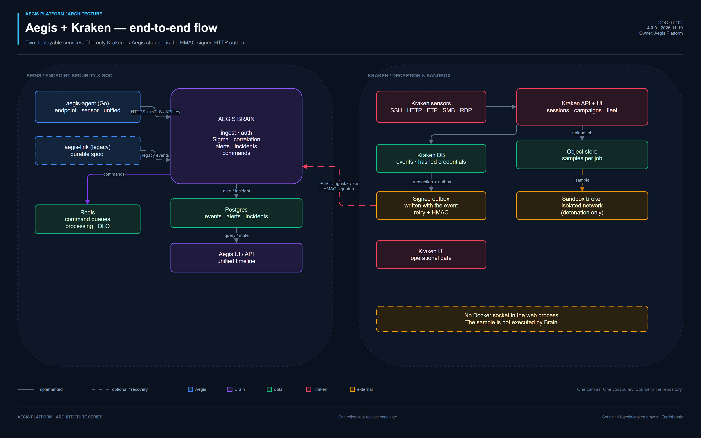
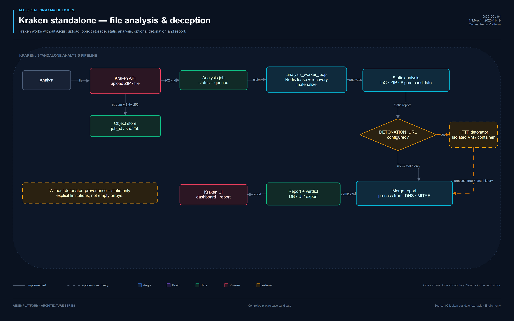
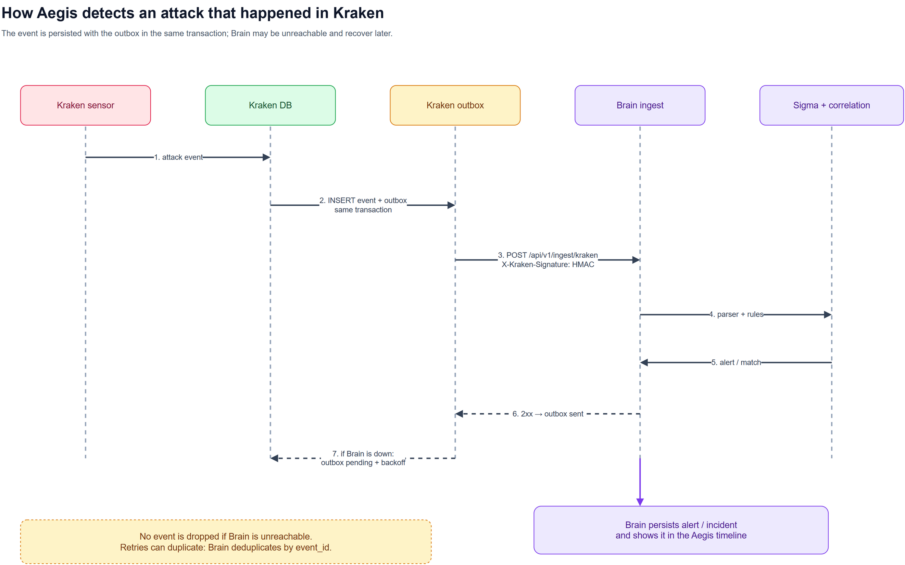
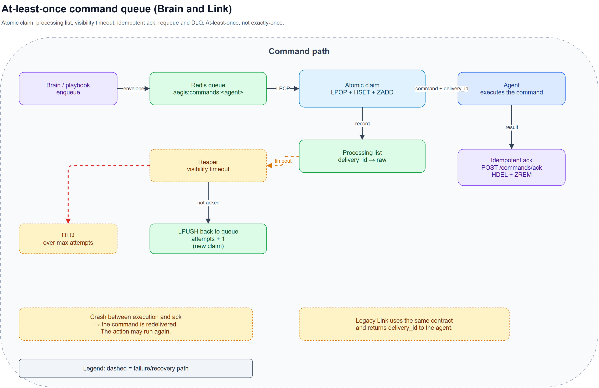

# Diagrams

All public diagrams in this directory are **English-only**. The editable source
is `*.drawio`; the exported `*.png` and `*.svg` files are generated from it.
Keep the source and exports in sync when a component is added or renamed.

## Gallery

### 1. Aegis + Kraken — end-to-end flow

[](./01-aegis-kraken.png)

[Editable source](./01-aegis-kraken.drawio) · [SVG](./01-aegis-kraken.svg)

### 2. Kraken standalone — file analysis and deception

[](./02-kraken-standalone.png)

[Editable source](./02-kraken-standalone.drawio) · [SVG](./02-kraken-standalone.svg)

### 3. Kraken → Aegis — signed event sequence

[](./03-kraken-to-aegis.png)

[Editable source](./03-kraken-to-aegis.drawio) · [SVG](./03-kraken-to-aegis.svg)

### 4. At-least-once command queue

[](./04-command-queue.png)

[Editable source](./04-command-queue.drawio) · [SVG](./04-command-queue.svg)

## Files

| Source | Purpose |
|---|---|
| `01-aegis-kraken.drawio` | End-to-end Aegis + Kraken architecture |
| `02-kraken-standalone.drawio` | Kraken standalone file-analysis pipeline |
| `03-kraken-to-aegis.drawio` | Kraken → Aegis event sequence |
| `04-command-queue.drawio` | At-least-once command queue |

## Export

Using the draw.io desktop CLI on Windows:

```bash
"/c/Program Files/draw.io/draw.io.exe" -x -f png -s 2 \
  -o docs/diagrams/01-aegis-kraken.png \
  docs/diagrams/01-aegis-kraken.drawio
```

Use `-f svg` for the SVG export. Generate the XML first with:

```bash
python scripts/generate_diagrams.py
```

## Conventions

- **Solid line:** control/data path that exists today.
- **Dashed line:** optional, external, retry, or failure/recovery path.
- **Green:** persisted state (Postgres, Redis, object store).
- **Purple:** Brain and Aegis control/UI.
- **Pink/red:** Kraken control/UI.
- **Amber:** external or optional component.
- No vendor logos, no marketing labels, no credentials.
- A new component must be added to `scripts/generate_diagrams.py` and to this
  table; do not hand-edit only the PNG.
